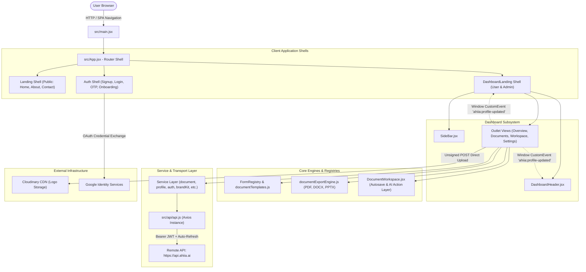
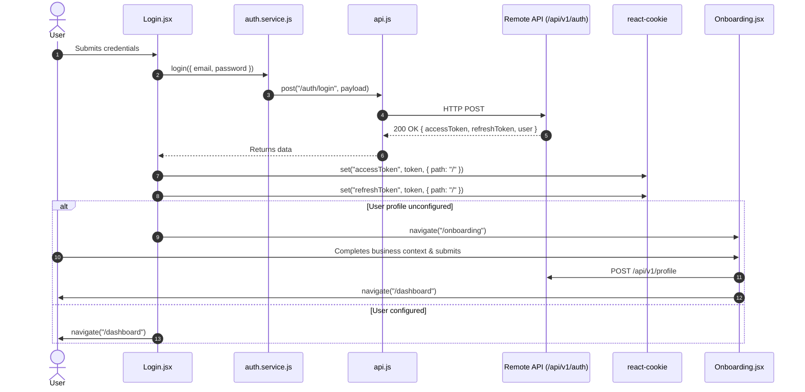
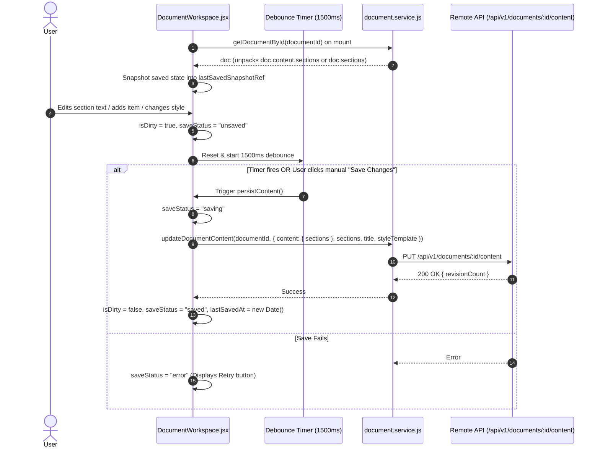
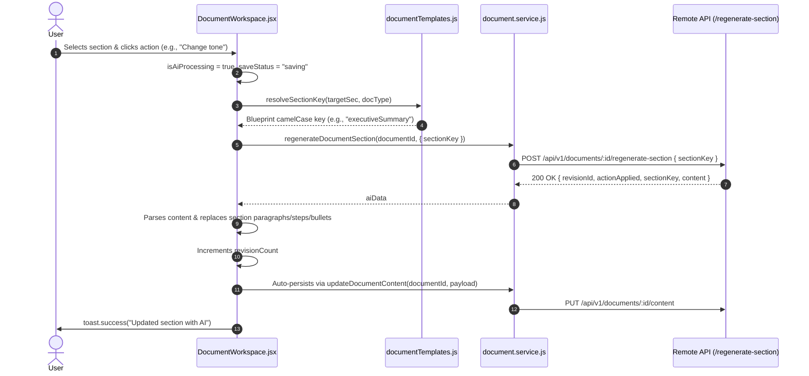
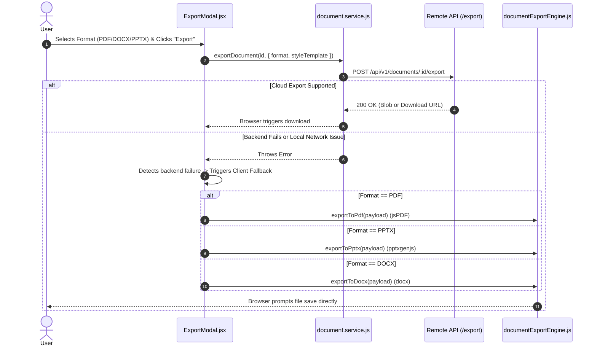
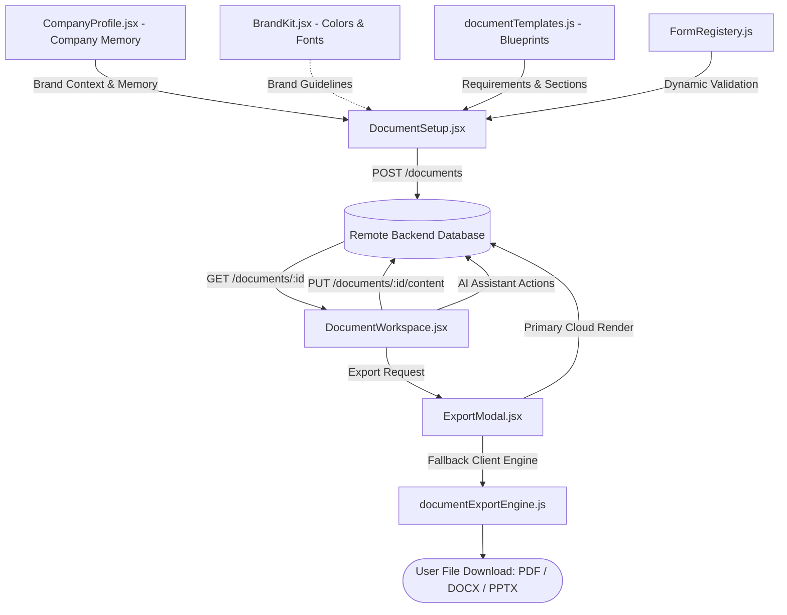

# Ahiia.AI — Definitive Architecture & Living System Source of Truth

> **Document Classification:** Single Source of Truth (SSOT)  
> **Scope:** Full System Architecture, Frontend Implementation, Service Integration, and Production State  
> **Repository:** `some` (Ahiia.AI Web Client)  
> **Audited Git HEAD:** Current Workspace  
> **Last Updated:** October 26, 2026  
> **Version:** 2.1.0  
> **Maintenance Protocol:** Living document governed by Section 14 (Living Documentation Protocol). Every PR modifying routes, endpoints, state boundaries, or service connections MUST update this reference.

---

## Table of Contents
1. [Platform Purpose, Vision & Context](#1-platform-purpose-vision--context)
2. [Macro System Architecture](#2-macro-system-architecture)
3. [Frontend Codebase Structure & Routing Registry](#3-frontend-codebase-structure--routing-registry)
4. [State Management & Data Architecture](#4-state-management--data-architecture)
5. [Transport, API Layer & External Integrations](#5-transport-api-layer--external-integrations)
6. [Feature Area Audit & Implementation Status Matrix](#6-feature-area-audit--implementation-status-matrix)
7. [Systematic Inventory of Mocks, Placeholders & Disconnected Endpoints](#7-systematic-inventory-of-mocks-placeholders--disconnected-endpoints)
8. [End-to-End User Workflows (Actual Code Traces)](#8-end-to-end-user-workflows-actual-code-traces)
9. [System Dependencies & Data Flow Topologies](#9-system-dependencies--data-flow-topologies)
10. [Known Limitations, Technical Debt & Risk Analysis](#10-known-limitations-technical-debt--risk-analysis)
11. [Architectural Decision Records (ADRs) & Engineering Conventions](#11-architectural-decision-records-adrs--engineering-conventions)
12. [Prioritized Implementation Roadmap & Sequencing](#12-prioritized-implementation-roadmap--sequencing)
13. [Debugging & Developer Operations Playbook](#13-debugging--developer-operations-playbook)
14. [Living Documentation Maintenance Protocol & Changelog](#14-living-documentation-maintenance-protocol--changelog)

---

## 1. Platform Purpose, Vision & Context

### 1.1 Problem Statement
African SMEs, consultants, founders, and enterprise teams spend disproportionate hours drafting business collateral (proposals, pitch decks, standard operating procedures, contracts, marketing strategies, and business plans). Generic LLM wrappers (such as raw ChatGPT or standard SaaS tools) suffer from three critical deficiencies:
1. **Lack of Local Market Context:** They fail to understand African business conventions, regional operational realities, and local pricing dynamics (defaulting to USD rather than Nigerian Naira ₦ / NGN).
2. **Amnesia Across Documents:** They require users to re-enter basic company memory (company name, mission, vision, competitive advantage, target market, leadership) for every document created.
3. **Fragile Formatting & Brand Inconsistency:** Raw AI output generates unformatted text blocks that require hours of manual conversion into publication-ready presentation decks (PPTX), corporate proposals (PDF), or Word policies (DOCX).

### 1.2 Platform Vision & Solution
**Ahiia.AI** is an AI-powered business intelligence and document generation platform built specifically for emerging enterprise markets. The platform:
- Persists structured **Company Profile Memory** and **Brand Kit Guidelines** (typography, corporate color palettes, logo assets).
- Employs a **Blueprint Architecture** where document types (e.g., SOP, Pitch Deck, Business Plan) map to structured input wizards and field completion rules.
- Integrates with a dedicated remote AI orchestration backend (`https://api.ahiia.ai`) to generate tailored, multi-section documents.
- Provides a rich, reactive **Document Workspace** featuring debounced autosave (`PUT /api/v1/documents/:id/content`), real-time dirty state tracking, section regeneration, and AI assistant actions.
- Operates a **Dual-Pipeline Export Engine** providing cloud rendering with fallback to client-side packaging (`jspdf`, `pptxgenjs`, `docx`) to guarantee document delivery even under backend cold starts or outages.

### 1.3 Reality vs. Aspiration Ground Rules
This document distinguishes between:
- **Production-Ready & Verified:** Features wired end-to-end to backend services, persisting across browser reloads, and verified in active code.
- **Partially Implemented:** Features with functional UI or services where integration is incomplete or missing secondary controls.
- **Mocked / Simulated:** UI components running against local React state, hardcoded arrays, or `setTimeout` delays.
- **Disconnected Backend Support:** Backend endpoints and service functions that exist in the codebase but have zero active consumers in the UI.

---

## 2. Macro System Architecture

Ahiia.AI is built as a client-side Single Page Application (SPA) communicating with an external REST API and third-party media and identity providers.



### 2.1 Technology Stack

| Layer | Technology | Version | Architectural Purpose |
|---|---|---|---|
| **Core Runtime** | React | `^19.0.0` | Declarative UI component library with modern JSX transform |
| **Build & Tooling** | Vite | `^6.2.0` | Ultra-fast HMR, ES module bundling, client environment configuration |
| **Routing** | React Router DOM | `^7.2.0` | Declarative client routing, nested layouts, outlet context passing |
| **Styling** | Tailwind CSS | `^4.0.9` | Utility-first styling via `@tailwindcss/vite` |
| **HTTP Transport** | Axios | `^1.8.1` | Central HTTP client with interceptors for token attachment and 401 refresh |
| **Iconography** | Lucide React / React Icons | `^1.16.0` / `^5.5.0` | Vector icon systems for dashboard actions and landing pages |
| **Notifications** | React Toastify | `^11.0.5` | Non-blocking system toasts for user feedback |
| **State / Cookies** | React Cookie | `^7.2.2` | Client cookie management for JWT tokens (`accessToken`, `refreshToken`) |
| **Client PDF Export** | jsPDF / html2canvas | `^4.2.1` / `^1.4.1` | Client-side Canvas-to-PDF and structured vector PDF compiler |
| **Client Word Export** | docx | `^9.14.0` | Client-side XML/ZIP compilation of styled `.docx` files |
| **Client Presentation** | pptxgenjs | `^4.0.1` | Client-side vector generation of 16:9 `.pptx` presentations |
| **Asset CDN** | Cloudinary | Unsigned REST | Direct-to-cloud asset storage for enterprise logos |

---

## 3. Frontend Codebase Structure & Routing Registry

### 3.1 Repository Tree Structure

```text
some/
├── .env.example                       # Documented environment variable template
├── ARCHITECTURE.md                    # Root single source of truth architectural document
├── docs/
│   └── ARCHITECTURE.md               # Mirror source of truth documentation
├── eslint.config.js                   # Flat ESLint rules configuration
├── index.html                         # SPA HTML entry point mounting div#root
├── package.json                       # Dependencies, lifecycle scripts, module metadata
├── public/                            # Static public web assets
├── src/
│   ├── main.jsx                       # Entry: mounts StrictMode, CookiesProvider, GoogleOAuthProvider
│   ├── App.jsx                        # Central Route and layout definitions
│   ├── index.css                      # Global Tailwind CSS v4 styling rules
│   ├── ScrollToTop.jsx                # Route navigation scroll reset utility
│   ├── api/
│   │   ├── api.js                     # Central Axios client with token refresh interceptor
│   │   └── endpoints.js               # Central dictionary of all API URL endpoints
│   ├── assets/                        # SVG logos, branding marks, and static vectors
│   ├── config/
│   │   ├── apiConfig.js               # Resolves BASE_URL from import.meta.env
│   │   └── documentTemplates.js       # Static blueprint catalogue (6 core document types)
│   ├── dashboard/
│   │   ├── DashboardLanding.jsx       # Layout shell for User and Admin dashboards
│   │   ├── adminDashboard/
│   │   │   └── AdminOverview.jsx      # Admin overview surface (mocked metrics)
│   │   ├── components/                # Shared dashboard widgets
│   │   │   ├── DashboardHeader.jsx    # Top bar: company initials, search, profile menu, logout
│   │   │   ├── SideBar.jsx            # Desktop & mobile responsive navigation drawer
│   │   │   ├── ExportModal.jsx        # Dual-pipeline export dialog (PDF, DOCX, PPTX)
│   │   │   └── document-setup/        # Dynamic form registry and wizard subcomponents
│   │   │       ├── FormRegistery.js   # Maps document types to dedicated setup forms
│   │   │       └── forms/             # 6 blueprint setup form implementations
│   │   └── userDashboard/             # Core end-user application views
│   │       ├── Overview.jsx           # Dashboard home: activity metrics, recent docs, templates
│   │       ├── Documents.jsx          # Document repository: search, filters, actions, duplicates
│   │       ├── CreateDocument.jsx     # Blueprint gallery for selecting new documents
│   │       ├── DocumentSetup.jsx      # Wizard interface for configuring document inputs
│   │       ├── DocumentWorkspace.jsx  # Rich document canvas: persistence, autosave, AI assistant
│   │       ├── CompanyProfile.jsx     # Company memory: mission, vision, audience, Cloudinary logo
│   │       ├── BrandKit.jsx           # Brand styling: colors, fonts, tagline, socialLinks (wired to /api/v1/brand-kit)
│   │       ├── Analytics.jsx          # Usage statistics and generator counts (wired to /api/v1/analytics/summary)
│   │       ├── Help.jsx               # Knowledge base, support, and documentation
│   │       └── settings/              # User settings tab views
│   │           ├── SettingsLanding.jsx # Tabs wrapper (Account, Security, Notifications)
│   │           ├── AccountSettings.jsx # Name & email (wired to /api/v1/user/me)
│   │           ├── SecuritySettings.jsx# Password reset trigger (wired to /api/v1/auth/forgot-password)
│   │           └── NotificationSettings.jsx # Notification toggles (wired to /api/v1/user/notification-preferences)
│   ├── hooks/
│   │   └── useScrollSpy.js            # Landing page navigation scroll spy hook
│   ├── landing/                       # Public website & authentication views
│   │   ├── Landing.jsx                # Public shell: navigation header & footer
│   │   ├── auth/                      # Authentication interfaces
│   │   │   ├── Signup.jsx             # Email/Password registration
│   │   │   ├── Login.jsx              # Credentials sign-in
│   │   │   ├── Otp.jsx                # Email OTP verification
│   │   │   ├── ForgotPassword.jsx     # Password reset request (wired to /api/v1/auth/forgot-password)
│   │   │   ├── ResetPassword.jsx      # Password reset completion (wired to /api/v1/auth/reset-password)
│   │   │   └── Onboarding.jsx         # Multi-step business context setup wizard
│   │   ├── components/                # Landing page presentation blocks (Hero, Features, Pricing)
│   │   └── pages/                     # Routed marketing views (Home, About, Contact)
│   ├── services/                      # API client service abstraction layer
│   │   ├── index.js                   # Barrel exports for all domain services
│   │   ├── admin.service.js           # Admin metrics, user management, and system health
│   │   ├── auth.service.js            # Login, register, OTP, refresh token, social auth
│   │   ├── brandKit.service.js        # Brand kit GET/PUT
│   │   ├── document.service.js        # Complete document CRUD, content, revisions, AI actions
│   │   ├── documentExportEngine.js    # Client-side jsPDF, docx, pptxgenjs compilation engine
│   │   ├── insights.service.js        # Overview insights and analytics summary
│   │   ├── profile.service.js         # Company profile CRUD, field updates, AI bio generation
│   │   ├── public.service.js          # Public waitlist and contact form endpoints
│   │   └── user.service.js            # Current user profile and notification preferences
│   └── utils/
│       ├── cloudinary.js              # Direct unsigned upload to Cloudinary CDN
│       └── smoothScroll.js            # Landing page smooth anchor scrolling helper
├── vercel.json                        # Vercel SPA rewrites and COOP headers for OAuth popups
└── vite.config.js                     # Vite build configuration and Tailwind plugin
```

### 3.2 Complete Route Registry

| Path | Component | Shell Layout | Guard Status | Implementation State |
|---|---|---|---|---|
| `/` | `Home.jsx` | `Landing.jsx` | Public | **Production-Ready** |
| `/about` | `About.jsx` | `Landing.jsx` | Public | **Placeholder** (`<div>About</div>`) |
| `/contact` | `Contact.jsx` | `Landing.jsx` | Public | **Placeholder** (`<div>Contact</div>`) |
| `/signup` | `Signup.jsx` | Standalone | Public | **Production-Ready** (wires `/api/v1/auth/register`) |
| `/login` | `Login.jsx` | Standalone | Public | **Production-Ready** (wires `/api/v1/auth/login`) |
| `/otp` | `Otp.jsx` | Standalone | Public | **Production-Ready** (wires `/api/v1/auth/verify-email`) |
| `/forgot-password` | `ForgotPassword.jsx` | Standalone | Public | **Production-Ready** (wires `/api/v1/auth/forgot-password`) |
| `/reset-password/:token`| `ResetPassword.jsx`| Standalone | Public | **Production-Ready** (wires `/api/v1/auth/reset-password` with route token) |
| `/onboarding` | `Onboarding.jsx` | Standalone | Public / Semi-auth | **Production-Ready** (wires `/api/v1/profile`) |
| `/dashboard` | `Overview.jsx` | `DashboardLanding.jsx` | Unprotected (Client) | **Production-Ready** (wires `/api/v1/dashboard`, dynamic greeting) |
| `/dashboard/overview` | `Overview.jsx` | `DashboardLanding.jsx` | Unprotected (Client) | **Production-Ready** (alias for `/dashboard`) |
| `/dashboard/documents` | `Documents.jsx` | `DashboardLanding.jsx` | Unprotected (Client) | **Production-Ready** (wires `/api/v1/documents`) |
| `/dashboard/documents/:documentId` | `DocumentWorkspace.jsx` | `DashboardLanding.jsx` | Unprotected (Client) | **Production-Ready** (wired PUT content, autosave, AI) |
| `/dashboard/document/:documentId` | `DocumentWorkspace.jsx` | `DashboardLanding.jsx` | Unprotected (Client) | **Production-Ready** (alias route for workspace) |
| `/dashboard/create-document` | `CreateDocument.jsx` | `DashboardLanding.jsx` | Unprotected (Client) | **Production-Ready** (blueprint selector gallery) |
| `/dashboard/create-document/:templateId` | `DocumentSetup.jsx` | `DashboardLanding.jsx` | Unprotected (Client) | **Production-Ready** (wires `/api/v1/documents` POST) |
| `/dashboard/company-profile` | `CompanyProfile.jsx` | `DashboardLanding.jsx` | Unprotected (Client) | **Production-Ready** (wires `/api/v1/profile`, Cloudinary) |
| `/dashboard/brand-kit` | `BrandKit.jsx` | `DashboardLanding.jsx` | Unprotected (Client) | **Production-Ready** (wires `/api/v1/brand-kit` GET/PUT) |
| `/dashboard/analytics` | `Analytics.jsx` | `DashboardLanding.jsx` | Unprotected (Client) | **Production-Ready** (wires `/api/v1/analytics/summary`) |
| `/dashboard/settings` | `SettingsLanding.jsx` | `DashboardLanding.jsx` | Unprotected (Client) | **Production-Ready** (tabs wrapper for account/security/notifications) |
| `/dashboard/settings/account` | `AccountSettings.jsx` | `DashboardLanding.jsx` | Unprotected (Client) | **Production-Ready** (wires `/api/v1/user/me` GET/PATCH) |
| `/dashboard/settings/security`| `SecuritySettings.jsx`| `DashboardLanding.jsx` | Unprotected (Client) | **Production-Ready** (wires `/api/v1/auth/forgot-password`) |
| `/dashboard/settings/notifications`| `NotificationSettings.jsx`| `DashboardLanding.jsx` | Unprotected (Client) | **Production-Ready** (wires `/api/v1/user/notification-preferences`) |
| `/dashboard/help` | `Help.jsx` | `DashboardLanding.jsx` | Unprotected (Client) | **Production-Ready** (static FAQ and resources) |
| `/admin` | `AdminOverview.jsx` | `DashboardLanding.jsx` (admin) | Unprotected (Client) | **Mocked** (static metric cards) |
| `/admin/overview` | `AdminOverview.jsx` | `DashboardLanding.jsx` (admin) | Unprotected (Client) | **Mocked** (alias route for admin) |
| `/admin/users` | *None* | `DashboardLanding.jsx` | Unrouted | **Dead End** (sidebar link renders blank page) |
| `/admin/verifications` | *None* | `DashboardLanding.jsx` | Unrouted | **Dead End** (sidebar link renders blank page) |
| `/admin/templates` | *None* | `DashboardLanding.jsx` | Unrouted | **Dead End** (sidebar link renders blank page) |
| `/admin/analytics` | *None* | `DashboardLanding.jsx` | Unrouted | **Dead End** (sidebar link renders blank page) |

---

## 4. State Management & Data Architecture

### 4.1 State Hierarchy (4 Tiers)
Ahiia.AI intentionally does not use heavy state libraries (Redux, Zustand, Recoil). State is isolated across four distinct architectural tiers:

```mermaid
graph TD
    subgraph Tier 1: Browser Session Cookies
        C1[accessToken - Bearer JWT]
        C2[refreshToken - Token Refresh]
        C3[userData - Google Auth Cache]
    end

    subgraph Tier 2: Layout Outlet Context
        O1[setHeaderTitle - Dynamic Route Header]
        O2[userProfile - Synchronized Company Info]
        O3[refreshProfile - Trigger Profile Refetch]
    end

    subgraph Tier 3: Component Local Memory
        M1[sections - Active Document Sections]
        M2[isDirty / saveStatus - Workspace State]
        M3[editingContent - Inline Editor Buffers]
        M4[formData - Document Wizard Inputs]
    end

    subgraph Tier 4: Transient Navigation State
        N1[location.state.document]
        N2[location.state.structuredInputs]
        N3[location.state.docTitle]
    end

    Tier 1 -->|Authorization Headers| Tier 3
    Tier 2 -->|Propagates Shell Metadata| Tier 3
    Tier 4 -->|Hydrates Workspace on Creation| Tier 3
```

1. **Browser Session Tier (Cookies):**
   - Managed via `react-cookie` (`path: "/"`).
   - Stores `accessToken` and `refreshToken`.
   - Read synchronously by Axios request interceptors to inject `Authorization: Bearer <token>`.
2. **Layout Outlet Context Tier:**
   - Supplied by `DashboardLanding.jsx` via `<Outlet context={{ setHeaderTitle, profile, userProfile, refreshProfile }} />`.
   - Allows child pages to update the header title and access the authenticated company profile.
3. **Component Local Memory Tier (`useState` / `useRef`):**
   - Encapsulates forms, active editor buffers, dirty states, and modals.
   - In `DocumentWorkspace.jsx`, `lastSavedSnapshotRef` preserves the exact JSON snapshot of the last persisted server state to perform dirty checking.
4. **Transient Navigation State Tier (`location.state`):**
   - Transmits initial document metadata and structured inputs from `DocumentSetup.jsx` to `DocumentWorkspace.jsx` immediately upon generation.

### 4.2 Cross-Component Event Synchronization (`ahiia:profile-updated`)
Because `DashboardLanding`, `DashboardHeader`, `CompanyProfile`, and `Overview` are decoupled, company profile mutations are broadcast using a native DOM `CustomEvent`:
- **Dispatched by:** `CompanyProfile.jsx` whenever a field is edited, business context is saved, or a logo is uploaded to Cloudinary.
- **Listened by:**
  - `DashboardLanding.jsx`: Re-fetches user profile to update sidebar branding.
  - `DashboardHeader.jsx`: Re-renders company name, avatar, and initials.
  - `Overview.jsx`: Re-fetches dashboard metrics without displaying full-screen loading spinners.

---

## 5. Transport, API Layer & External Integrations

### 5.1 Central Axios Transport (`src/api/api.js`)
All HTTP communication flows through a unified Axios instance:
- **Base URL:** Resolved from `VITE_API_URL` (defaulting to `https://www.api.ahiia.ai`).
- **Timeout:** Set to `60000ms` (60 seconds) specifically to accommodate backend cold starts on Render/cloud hosting.
- **Request Interceptor:** Reads `accessToken` from cookies and injects `Authorization: Bearer ${token}`.
- **Response Interceptor (Token Refresh):**
  - Detects 401 Unauthorized errors where `error.response?.data?.detail === "Invalid or expired token"`.
  - Flags `originalRequest._retry = true` to prevent infinite refresh loops.
  - Calls `refreshTokenApi({ refreshToken })`, saves the new `access_token` to cookies, updates the failed request header, and replays the request.
  - If refresh fails, it purges cookies (`accessToken`, `refreshToken`, `userData`), triggers a toast alert, and forces a browser redirect to `/login`.

### 5.2 API Catalog & Endpoint Mapping

```text
Base URL: https://api.ahiia.ai (or VITE_API_URL)
Prefix: /api/v1
```

| Domain | Method | Endpoint Path | Function in Service Layer | Current UI Consumer |
|---|---|---|---|---|
| **Auth** | `POST` | `/auth/register` | `register(payload)` | `Signup.jsx` |
| **Auth** | `POST` | `/auth/login` | `login(payload)` | `Login.jsx` |
| **Auth** | `POST` | `/auth/logout` | `logout()` | `DashboardHeader.jsx` |
| **Auth** | `POST` | `/auth/verify-email` | `verifyEmail(payload)` | `Otp.jsx` |
| **Auth** | `POST` | `/auth/resend-verification` | `resendVerification(payload)` | `Otp.jsx` |
| **Auth** | `POST` | `/auth/forgot-password` | `forgotPassword(payload)` | `ForgotPassword.jsx`, `SecuritySettings.jsx` |
| **Auth** | `POST` | `/auth/reset-password` | `resetPassword(payload)` | `ResetPassword.jsx` |
| **Auth** | `POST` | `/auth/google` | `googleAuth(payload)` | `GoogleAuthButton.jsx` |
| **Auth** | `POST` | `/auth/refresh` | `refreshToken(payload)` | `api.js` (Response Interceptor) |
| **Auth** | `POST` | `/admin/register` | `adminRegister(payload)` | **None** |
| **User** | `GET` | `/user/me` | `getCurrentUser()` | `AccountSettings.jsx`, `DashboardLanding.jsx` |
| **User** | `PATCH` | `/user/me` | `updateCurrentUser(payload)` | `AccountSettings.jsx` |
| **User** | `GET` | `/user/notification-preferences`| `getNotificationPreferences()` | `NotificationSettings.jsx` |
| **User** | `PUT` | `/user/notification-preferences`| `updateNotificationPreferences(p)`| `NotificationSettings.jsx` |
| **Profile**| `GET` | `/profile` | `getUserProfile()` | `DashboardLanding.jsx`, `Workspace.jsx` |
| **Profile**| `POST` | `/profile` | `createUserProfile(payload)` | `Onboarding.jsx` |
| **Profile**| `PATCH`| `/profile` | `updateUserProfile(payload)` | `CompanyProfile.jsx` |
| **Profile**| `PATCH`| `/profile/:field` | `updateProfileField(field, val)` | `CompanyProfile.jsx` |
| **Profile**| `POST` | `/profile/business-context` | `saveBusinessContext(payload)` | `CompanyProfile.jsx` |
| **Profile**| `POST` | `/profile/ai-complete` | `createAiProfile(payload)` | `Onboarding.jsx` |
| **BrandKit**| `GET` | `/brand-kit` | `getBrandKit()` | `DocumentWorkspace.jsx`, `BrandKit.jsx` |
| **BrandKit**| `PUT` | `/brand-kit` | `updateBrandKit(payload)` | `BrandKit.jsx` |
| **Blueprints**| `GET` | `/blueprints` | `getBlueprints()` | `CreateDocument.jsx` |
| **Blueprints**| `GET` | `/blueprints/:documentType` | `getBlueprintByType(type)` | `DocumentSetup.jsx` |
| **Drafts** | `POST` | `/document-drafts` | `createDocumentDraft(payload)` | `DocumentSetup.jsx` |
| **Drafts** | `GET` | `/document-drafts` | `getDocumentDrafts()` | **None** (No Drafts listing view) |
| **Drafts** | `GET` | `/document-drafts/:id` | `getDocumentDraftById(id)` | **None** |
| **Drafts** | `POST` | `/document-drafts/:id/generate` | `generateFromDraft(id)` | **None** |
| **Documents**| `GET` | `/documents` | `getDocuments(params)` | `Documents.jsx` |
| **Documents**| `POST` | `/documents` | `createDocument(payload)` | `DocumentSetup.jsx` |
| **Documents**| `GET` | `/documents/:id` | `getDocumentById(id)` | `DocumentWorkspace.jsx` |
| **Documents**| `PUT` | `/documents/:id/content` | `updateDocumentContent(id, p)` | `DocumentWorkspace.jsx` (Autosave & manual) |
| **Documents**| `PATCH`| `/documents/:id/style` | `updateDocumentStyle(id, p)` | `DocumentWorkspace.jsx` |
| **Documents**| `PATCH`| `/documents/:id/status` | `updateDocumentStatus(id, p)` | `Documents.jsx` |
| **Documents**| `POST` | `/documents/:id/duplicate` | `duplicateDocument(id)` | `Documents.jsx`, `Overview.jsx` |
| **Documents**| `DELETE`| `/documents/:id` | `deleteDocument(id)` | `Documents.jsx`, `Overview.jsx` |
| **Documents**| `POST` | `/documents/:id/regenerate-section`| `regenerateDocumentSection(id, p)`| `DocumentWorkspace.jsx` (Strict `{ sectionKey }`) |
| **Documents**| `POST` | `/documents/:id/assistant-action` | `documentAssistantAction(id, p)` | `DocumentWorkspace.jsx` (AI Action) |
| **Documents**| `GET` | `/documents/:id/revisions` | `getDocumentRevisions(id)` | **None** (Revisions drawer not mounted) |
| **Documents**| `POST` | `/documents/:id/revert` | `revertDocument(id, p)` | **None** |
| **Documents**| `GET` | `/documents/:id/guidance` | `getDocumentGuidance(id)` | **None** (Guidance drawer not mounted) |
| **Documents**| `PATCH`| `/documents/:id/guidance/:flagId` | `updateDocumentGuidance(id, f, p)`| **None** |
| **Documents**| `POST` | `/documents/:id/export` | `exportDocument(id, p)` | `ExportModal.jsx` (Primary cloud export) |
| **Insights**| `GET` | `/dashboard` | `getDashboardInsights()` | `Overview.jsx` |
| **Insights**| `GET` | `/analytics/summary` | `getAnalyticsSummary()` | `Analytics.jsx` |
| **Public** | `POST` | `/public/waitlist` | `joinWaitlist(payload)` | **None** |
| **Public** | `POST` | `/public/contact` | `submitContactForm(payload)` | **None** (`Contact.jsx` is placeholder) |
| **Admin** | `GET` | `/admin/overview` | `getAdminOverview()` | **None** (`AdminOverview.jsx` is mocked) |
| **Admin** | `GET` | `/admin/users` | `getAdminUsers(params)` | **None** (Route unmounted) |
| **Admin** | `GET` | `/admin/users/:id` | `getAdminUserById(id)` | **None** |
| **Admin** | `DELETE`| `/admin/users/:id` | `deleteAdminUser(id)` | **None** |
| **Admin** | `PATCH`| `/admin/users/:id/status`| `updateAdminUserStatus(id, p)`| **None** |
| **Admin** | `GET` | `/admin/documents` | `getAdminDocuments(params)` | **None** |
| **Admin** | `GET` | `/admin/generations` | `getAdminGenerations(params)` | **None** |
| **Admin** | `GET` | `/admin/ai-usage` | `getAdminAiUsage(params)` | **None** |
| **Admin** | `GET` | `/admin/system-health` | `getAdminSystemHealth()` | **None** |

### 5.3 External Integrations Contract Matrix

| Service | Mechanism | Authentication | Failure Handling | Production State |
|---|---|---|---|---|
| **Ahiia API** | HTTPS REST | JWT Bearer in `Authorization` header | 60s timeout, silent 401 refresh, toast error surfacing | **Production-Ready** |
| **Cloudinary** | Unsigned REST POST | Upload Preset (`Ahiia.AI`), Cloud Name | Rejection caught, surfaces error toast, preserves previous logo | **Production-Ready** |
| **Google OAuth** | Popup Credential Exchange | Client ID (`VITE_GOOGLE_CLIENT_ID`) | User closure or failure caught, fallback to email login | **Production-Ready** |
| **jsPDF** | Pure Client JS | None | Caught in `ExportModal`, surfaces failure toast | **Production-Ready** |
| **PptxGenJS** | Pure Client JS | None | Caught in `ExportModal`, surfaces failure toast | **Production-Ready** |
| **Docx** | Pure Client JS | None | Caught in `ExportModal`, surfaces failure toast | **Production-Ready** |

---

## 6. Feature Area Audit & Implementation Status Matrix

### 6.1 Authentication & Onboarding
- **Status:** **Production-Ready**
- **Primary Files:** `Signup.jsx`, `Login.jsx`, `Otp.jsx`, `Onboarding.jsx`, `GoogleAuthButton.jsx`, `auth.service.js`
- **What Works:**
  - Email/password user registration and login.
  - Email verification OTP flow.
  - Google Social Login via `@react-oauth/google` popup.
  - Multi-step business onboarding capturing industry, company size, mission, and target market.
  - AI Profile Bio generation (`/api/v1/profile/ai-complete`).
  - Password recovery wired end-to-end: `ForgotPassword.jsx` calls `forgotPassword({ email })`, and `ResetPassword.jsx` extracts route `:token` to call `resetPassword({ token, newPassword })`.
- **Gaps / Incomplete:**
  - Public marketing stubs (`About.jsx`, `Contact.jsx`).

### 6.2 Company Profile & Business Context Memory
- **Status:** **Production-Ready**
- **Primary Files:** `CompanyProfile.jsx`, `profile.service.js`, `cloudinary.js`
- **What Works:**
  - Fetching company profile memory on load.
  - Inline editing of individual business fields (`/api/v1/profile/:field`).
  - Batch editing of comprehensive business context (`/api/v1/profile/business-context`).
  - Direct logo upload to Cloudinary CDN returning permanent URL saved to profile.
  - Broadcasting `ahiia:profile-updated` to keep header, overview, and sidebar in sync.

### 6.3 Document Blueprints & Dynamic Form Registry
- **Status:** **Production-Ready**
- **Primary Files:** `CreateDocument.jsx`, `DocumentSetup.jsx`, `documentTemplates.js`, `FormRegistery.js`, `forms/*`
- **What Works:**
  - 6 fully realized document blueprint wizards: Business Proposal, Pitch Deck, Standard Operating Procedure (SOP), Contract, Marketing Plan, Business Plan.
  - Dynamic Form Registry architecture mapping blueprint slugs to dedicated form inputs and completion calculators.
  - Section completion validation (`getCompletedSections`) ensuring required fields are filled before enabling document generation.
  - Generation payload formatting strictly enforcing `structuredInputs` as a native JSON Object.

### 6.4 Document Workspace & Persistence Layer
- **Status:** **Production-Ready**
- **Primary Files:** `DocumentWorkspace.jsx`, `document.service.js`
- **What Works:**
  - **Server Content Synchronization:** Full document updates persist via `PUT /api/v1/documents/:id/content` with payload `{ content: { sections }, sections, title, styleTemplate }`.
  - **Survival Across Refresh:** `loadWorkspaceData` unpacks structured sections from `doc.content.sections`, `doc.content` (including JSON strings), and `doc.sections`.
  - **Debounced Autosave:** Automatically persists changes 1500ms after user edits with dirty state tracking against `lastSavedSnapshotRef`.
  - **Visual Status Badging:** Real-time indicator displaying `saving` (with spinner), `unsaved` (amber pulse), `saved` (green check + timestamp), and `error` (red alert + retry button).
  - **Manual Save Button:** Dedicated toolbar control that illuminates when dirty and disables when saved.
  - **Unsaved Changes Shield:** Window `beforeunload` listener intercepts navigation or tab close if `isDirty` is true.
  - **Real AI Assistant Actions:**
    - Section regeneration calls `/api/v1/documents/:id/regenerate-section`, merges the regenerated section, and immediately persists to backend content.
    - Whole-document refinement calls `/api/v1/documents/:id/assistant-action` and immediately persists.
    - Zero synthetic fallbacks; API errors surface genuine error toasts.
  - **Section Editing & Mutations:** In-place section editing, section deletion, and item addition persist directly to the server.
  - **Dynamic Visual Styles:** Switches between Corporate, Minimal, and Creative style layouts and updates style via API.
- **Gaps / Incomplete:**
  - Guidance flag drawer is not yet mounted to the UI (backend endpoints exist).
  - Revision history drawer is not yet mounted to the UI (backend endpoints exist).

### 6.5 Document Export Pipeline
- **Status:** **Production-Ready (Dual Cloud / Client Engine)**
- **Primary Files:** `ExportModal.jsx`, `documentExportEngine.js`, `document.service.js`
- **What Works:**
  - Type-safe format restrictions (e.g., Pitch Deck supports PPTX/PDF; Proposals/SOPs support PDF/DOCX).
  - Cloud-First Export: Dispatches export request to backend `/api/v1/documents/:id/export`.
  - Transparent Client Fallback: If backend export errors or fails, client engine seamlessly generates the document using `jspdf`, `pptxgenjs`, or `docx` respecting selected styles, company profile initials, and brand colors.
  - Direct file download triggers in browser.

### 6.6 Document Repository & Overview Dashboard
- **Status:** **Production-Ready**
- **Primary Files:** `Documents.jsx`, `Overview.jsx`, `document.service.js`, `insights.service.js`
- **What Works:**
  - Document catalog fetching via `GET /api/v1/documents`.
  - Search filtering by title and metadata.
  - Category filtering by blueprint type and status (Draft, Finalized, Exported).
  - Document duplication (`POST /api/v1/documents/:id/duplicate`).
  - Document deletion (`DELETE /api/v1/documents/:id`).
  - Dashboard overview metrics fetching via `GET /api/v1/dashboard`.
  - Re-fetching metrics automatically upon `ahiia:profile-updated`.

### 6.7 Brand Kit Surface
- **Status:** **Production-Ready**
- **Primary Files:** `BrandKit.jsx`, `brandKit.service.js`
- **Current Reality:**
  - `BrandKit.jsx` connects to `getBrandKit()` on component mount to populate typography, primary/secondary colors, tagline, and social links.
  - "Save Changes" invokes `updateBrandKit(payload)` with native JSON array `socialLinks` (avoiding schema 400 errors).
  - Integrates direct Cloudinary logo uploading and broadcasts `ahiia:profile-updated`.

### 6.8 User Settings Surface
- **Status:** **Production-Ready**
- **Primary Files:** `SettingsLanding.jsx`, `AccountSettings.jsx`, `SecuritySettings.jsx`, `NotificationSettings.jsx`, `user.service.js`, `auth.service.js`
- **Current Reality:**
  - `AccountSettings.jsx`: Fetches current user via `getCurrentUser()` on mount; updates user name via `updateCurrentUser({ fullName })` on save.
  - `SecuritySettings.jsx`: Wires the "Change password" action directly to `forgotPassword({ email })` for authenticated password reset email dispatch.
  - `NotificationSettings.jsx`: Fetches preferences via `getNotificationPreferences()` on mount; updates preferences live via `updateNotificationPreferences(prefs)`.

### 6.9 Analytics Surface
- **Status:** **Production-Ready**
- **Primary Files:** `Analytics.jsx`, `insights.service.js`
- **Current Reality:**
  - `Analytics.jsx` calls `getAnalyticsSummary()` on mount.
  - Displays real document counts, AI edit counters, generator distributions, and live recent generation activity.

### 6.10 Dashboard Header & Overview Shell
- **Status:** **Production-Ready**
- **Primary Files:** `DashboardHeader.jsx`, `Overview.jsx`
- **Current Reality:**
  - `DashboardHeader.jsx` provides a clean top bar with search, notification dropdown, and dark blue company profile dropdown pill. The redundant static white company badge has been cleanly removed to maintain seamless right-alignment.
  - `Overview.jsx` dynamically calculates time-of-day greetings ("Good morning", "Good afternoon", "Good evening") based on the client browser's local time.

### 6.10 Admin Dashboard
- **Status:** **Mocked & Unrouted**
- **Primary Files:** `AdminOverview.jsx`, `SideBar.jsx`, `App.jsx`, `admin.service.js`
- **Current Reality:**
  - `/admin` renders `AdminOverview.jsx` with static mock counters (`1,420` users, `12` verifications).
  - Admin sidebar links (`/admin/users`, `/admin/verifications`, `/admin/templates`, `/admin/analytics`) are not registered in `App.jsx`, rendering blank pages when clicked.
  - **Backend Support:** `admin.service.js` defines full management endpoints (`getAdminUsers`, `updateAdminUserStatus`, `getAdminDocuments`, `getAdminGenerations`, `getAdminAiUsage`, `getAdminSystemHealth`).
  - **Why Incomplete:** Admin pages were never authored or routed beyond the initial overview shell.

### 6.11 Public Landing, About & Contact Pages
- **Status:** **Partially Implemented**
- **Primary Files:** `Home.jsx`, `About.jsx`, `Contact.jsx`, `public.service.js`
- **Current Reality:**
  - `Home.jsx` is fully functional with interactive preview widgets, template carousels, and auth redirects.
  - `About.jsx` is a stub: `return <div>About</div>;`.
  - `Contact.jsx` is a stub: `return <div>Contact</div>;`.
  - **Backend Support:** `public.service.js` defines `joinWaitlist(payload)` and `submitContactForm(payload)` connected to `/api/v1/public/*`.

---

## 7. Systematic Inventory of Mocks, Placeholders & Disconnected Endpoints

### 7.1 Master Implementation Status Ledger

| Feature / Area | Production Ready? | Mocked / Simulated Behavior | Disconnected Backend Endpoint | Source Files |
|---|---|---|---|---|
| **Document Workspace Persistence** | **YES** | None. Persists via PUT, debounced autosave, dirty tracking. | None. | `DocumentWorkspace.jsx` |
| **Document AI Actions** | **YES** | None. Wires `regenerate-section` and `assistant-action`. | None. | `DocumentWorkspace.jsx` |
| **Document Creation Wizard** | **YES** | None. Wires POST `/api/v1/documents`, requires valid server ID. | None. | `DocumentSetup.jsx` |
| **Document Export** | **YES** | Dual pipeline: Cloud API first, client engine fallback. | None. | `ExportModal.jsx` |
| **Company Profile** | **YES** | None. Wires PATCH endpoints, Cloudinary logo uploads. | None. | `CompanyProfile.jsx` |
| **Authentication** | **YES** | None. Register, Login, OTP, Google OAuth fully wired. | None. | `Login.jsx`, `Signup.jsx`, `Otp.jsx` |
| **Password Recovery** | **YES** | None. Wires `forgotPassword` & `resetPassword`. | None. | `ForgotPassword.jsx`, `ResetPassword.jsx` |
| **Brand Kit** | **YES** | None. Wires `getBrandKit` & `updateBrandKit`. | None. | `BrandKit.jsx`, `brandKit.service.js` |
| **Account Settings** | **YES** | None. Wires `getCurrentUser` & `updateCurrentUser`.| None. | `AccountSettings.jsx`, `user.service.js` |
| **Security Settings** | **YES** | None. Wires password reset via `forgotPassword`. | None. | `SecuritySettings.jsx`, `auth.service.js` |
| **Notification Settings**| **YES** | None. Wires `getNotificationPreferences` & updates. | None. | `NotificationSettings.jsx`, `user.service.js` |
| **Analytics Dashboard** | **YES** | None. Wires `getAnalyticsSummary()` live stats. | None. | `Analytics.jsx`, `insights.service.js` |
| **Admin Overview** | **NO** | Static mock metrics (1,420 users, 99.98% uptime). | `GET /api/v1/admin/overview` | `AdminOverview.jsx`, `admin.service.js` |
| **Admin Management** | **NO** | Unrouted in `App.jsx` (Dead ends). | `/admin/users`, `/admin/documents`, etc. | `SideBar.jsx`, `admin.service.js` |
| **Document Guidance** | **NO** | Guidance drawer component not yet mounted to workspace. | `GET/PATCH /documents/:id/guidance` | `document.service.js` |
| **Document Revisions** | **NO** | Revision drawer/revert modal not mounted to workspace. | `GET /documents/:id/revisions`, `/revert`| `document.service.js` |
| **Document Drafts** | **NO** | Drafts saved by Setup, but no Drafts list/resume UI. | `GET /document-drafts`, `/generate` | `document.service.js` |
| **Public About / Contact**| **NO** | Stubs returning `<div>About</div>` and `<div>Contact</div>`.| `POST /api/v1/public/contact` | `About.jsx`, `Contact.jsx`, `public.service.js` |

---

## 8. End-to-End User Workflows (Actual Code Traces)

### 8.1 Workflow 1: Authentication & Onboarding


### 8.2 Workflow 2: Document Creation & Generation
```mermaid
sequenceDiagram
    autonumber
    actor User
    participant Create as CreateDocument.jsx
    participant Setup as DocumentSetup.jsx
    participant Registry as FormRegistery.js
    participant DocSvc as document.service.js
    participant Backend as Remote API (/api/v1/documents)
    participant Workspace as DocumentWorkspace.jsx

    User->>Create: Selects Blueprint (e.g., SOP, Pitch Deck)
    Create->>Setup: navigate("/dashboard/create-document/:templateId")
    Setup->>Registry: getFormRegistryEntry(templateId)
    Registry-->>Setup: Form component & getCompletedSections()
    User->>Setup: Fills required sections & style
    Setup->>Setup: Validates all requiredSections complete
    User->>Setup: Clicks "Generate Document"
    Setup->>Setup: buildPayload() (structuredInputs as native JSON Object)
    Setup->>DocSvc: createDocument(payload)
    DocSvc->>Backend: POST /api/v1/documents
    alt Server Success
        Backend-->>DocSvc: 201 Created { id: "doc_abc123", ... }
        DocSvc-->>Setup: result
        Setup->>Workspace: navigate("/dashboard/documents/doc_abc123", state)
    else Server Failure
        Backend-->>DocSvc: 4xx/5xx Error
        DocSvc-->>Setup: Throws AxiosError
        Setup->>User: toast.error("Failed to generate document") (Form state preserved)
    end
```

### 8.3 Workflow 3: Document Workspace Persistence & Autosave


### 8.4 Workflow 4: AI Section Regeneration & Assistant Action


### 8.5 Workflow 5: Dual-Pipeline Document Export


---

## 9. System Dependencies & Data Flow Topologies



---

## 10. Known Limitations, Technical Debt & Risk Analysis

### 10.1 High-Risk Areas
1. **Circular Import Dependency in Transport (`src/api/api.js` <-> `src/services/auth.service.js`):**
   - `api.js` imports `refreshToken` from `auth.service.js`.
   - `auth.service.js` imports `api` from `api.js`.
   - **Risk:** Bundler tree-shaking or code-splitting restructuring can cause module initialization order to evaluate `api` as `undefined`, causing sudden runtime crashes.
   - **Remedy:** Extract `refreshTokenApi` into a dedicated transport helper (`src/api/tokenRefresh.js`) uncoupled from domain services.
2. **XSS Exposure of Session Tokens in Browser Cookies:**
   - Both `accessToken` and `refreshToken` are stored in non-`HttpOnly` cookies via `react-cookie` to allow Axios interceptor access.
   - **Risk:** Any cross-site scripting vulnerability in third-party dependencies can access and exfiltrate user credentials.
   - **Remedy:** Migrate refresh token storage to `HttpOnly` server-managed cookies and keep access tokens in application memory with silent background refresh.
3. **No Route Guards on Dashboard & Admin Shells:**
   - Routes under `/dashboard/*` and `/admin/*` do not evaluate token presence before mounting.
   - **Risk:** Unauthenticated users can load private dashboard interfaces; requests fail only when background API calls return 401.
   - **Remedy:** Implement an `<AuthGuard>` wrapper component in `src/App.jsx` redirecting to `/login` if `accessToken` cookie is absent.
4. **Environment Secret Variable Bundling Risk (`.env.example`):**
   - `.env.example` lists `VITE_CLOUDINARY_API_SECRET`.
   - **Risk:** Vite exposes ANY variable prefixed with `VITE_` directly into the public client JavaScript bundle. If a developer populates this value, the Cloudinary secret key becomes visible to anyone inspecting the bundle.
   - **Remedy:** Remove `VITE_CLOUDINARY_API_SECRET` from `.env.example`. Cloudinary uploads use unsigned presets and require only `VITE_CLOUDINARY_CLOUD_NAME` and `VITE_CLOUDINARY_UPLOAD_PRESET`.

### 10.2 Technical Debt
1. **Dead Admin Navigation Links:**
   - `SideBar.jsx` advertises `/admin/users`, `/admin/verifications`, `/admin/templates`, and `/admin/analytics`, but none of these routes exist in `App.jsx`.
2. **Redundant Installed Package:**
   - `package.json` installs both `react-cookie` and `react-cookies`. Only `react-cookie` is imported. `react-cookies` is dead weight.
3. **Absence of Client Telemetry & Observability:**
   - No crash-reporting SDK (Sentry, LogRocket, Datadog) is installed. Client errors and failed network calls are logged solely to user browser consoles.

---

## 11. Architectural Decision Records (ADRs) & Engineering Conventions

### ADR-1: Pure Component-Local State Without Redux or Zustand
- **Decision:** Do not introduce external global state containers (Redux, Zustand, Recoil).
- **Rationale:** Application data models are domain-isolated. Document workspace state is document-specific, form wizard state is wizard-specific, and layout shell state is lightweight.
- **Convention:** State must be kept in local component hooks (`useState`, `useRef`), URL search parameters, or passed via React Router `<Outlet context={{ ... }} />`.

### ADR-2: Decoupled Shell Communication via Window CustomEvent
- **Decision:** Use native DOM `CustomEvent('ahiia:profile-updated')` to synchronize company profile changes across distant layout components.
- **Rationale:** Eliminates prop-drilling through React Router layouts while avoiding the overhead of a global store.
- **Convention:** Any component mutating company profile data MUST dispatch `window.dispatchEvent(new CustomEvent("ahiia:profile-updated", { detail }))`.

### ADR-3: Dual-Pipeline Export Architecture (Cloud First, Client Fallback)
- **Decision:** Document exporting must attempt remote backend rendering first, falling back to client-side packaging engines (`jspdf`, `pptxgenjs`, `docx`) upon failure.
- **Rationale:** Server-side headless browser rendering provides optimal typography, but remote servers can suffer cold starts or network timeouts. Client compilation guarantees the user never leaves empty-handed.
- **Convention:** All export actions MUST route through `ExportModal.jsx` utilizing the dual-pipeline pattern.

### ADR-4: Native JSON Object Contract for `structuredInputs`
- **Decision:** The `structuredInputs` property in document generation payloads MUST be a native JSON Object, NEVER a stringified JSON string (`JSON.stringify`).
- **Rationale:** The backend API validator enforces JSON object schema validation and rejects stringified payloads.

### ADR-5: Form Registry Pattern for Blueprint Completion
- **Decision:** Blueprint wizards must register in `FORM_REGISTRY` in `FormRegistery.js`, exporting a default React form and a named `getCompletedSections(formData)` validator.
- **Rationale:** Standardizes wizard section validation across diverse document types without hardcoding form logic inside `DocumentSetup.jsx`.

### ADR-6: Elimination of Synthetic Fallbacks on Mutation Boundaries
- **Decision:** Server mutation endpoints (Document Creation, Content PUT, AI Actions) MUST NOT catch errors and fabricate synthetic mock IDs or strings (`bp_${Date.now()}`).
- **Rationale:** Synthetic fallbacks mask backend outages, produce phantom state, and mislead users and developers. Real errors must be surfaced honestly via toast notifications while preserving user input buffers.

### ADR-7: Blueprint SectionKey Normalization for AI Regeneration
- **Decision:** Section regeneration via `POST /api/v1/documents/:id/regenerate-section` MUST resolve blueprint camelCase keys (e.g. `executiveSummary`, `scopeOfWork`, `timeline`, `theProcess`) via `resolveSectionKey(section, docType)` and send strictly `{ sectionKey: string }`.
- **Rationale:** The remote document blueprint validator validates against registered blueprint section keys. Kebab-case IDs (`"executive-summary"`) trigger `SECTION_NOT_FOUND`, and extraneous properties (`prompt`, `sectionId`) violate the schema.

### ADR-8: Native JSON Payloads for Structured Collections
- **Decision:** Structured nested collections (e.g., `socialLinks` in `/api/v1/brand-kit`, `structuredInputs` in `/api/v1/documents`) MUST be transmitted as native JSON objects or arrays, NEVER double-encoded with `JSON.stringify`.
- **Rationale:** Backend schema validation checks that arrays and objects match native JSON data structures. Stringified JSON causes 400 Bad Request errors (`INVALID_SOCIAL_LINKS`).

### ADR-9: Native Section-Keyed JSON Object for Document Content Persistence
- **Decision:** Document content updates via `PUT /api/v1/documents/:id/content` MUST transmit `{ content: { [sectionKey]: "non-empty string" } }` where `content` is a native JSON object (NEVER double-encoded as a string via `JSON.stringify`), and every blueprint section key maps to a non-empty string value (`buildDocumentContentPayload`).
- **Rationale:** The remote content validator explicitly rejects serialized JSON strings with `"Document content must be a section-keyed JSON object."` and rejects complex/empty nested objects with `"Every document section must have a non-empty string value."`. The backend requires `content` to be a plain JSON object whose keys match blueprint section keys and whose values are non-empty text strings.

### ADR-10: Asynchronous Document Generation & Polling Queue
- **Decision:** Document generation from `DocumentSetup.jsx` utilizes an asynchronous polling queue (`POST /api/v1/document-generations` with `Idempotency-Key` header and polling `GET /api/v1/document-generations/:id`).
- **Rationale:** Generation workflows involve complex AI orchestration, company profile ingestion, and brand styling that can exceed single synchronous HTTP request timeouts.
- **Convention:** The client stores `requestKey`, `payload`, `templateId`, and `job` in `sessionStorage` (`ahiia_pending_generation`). On refresh or navigation return, polling resumes idempotently. The UI displays the exact status string from the backend alongside an indeterminate loader (no fake progress percentages). Cancelling stops client polling via `AbortController` while server-side generation continues in the background. If `/api/v1/document-generations` returns 404 (prior to backend rollout), the client transparently falls back to synchronous `POST /api/v1/documents`.


---

## 12. Prioritized Implementation Roadmap & Sequencing

### Phase 1: High-Impact Service Wiring (COMPLETED)
*All target endpoints have been connected and verified.*
- [x] **Brand Kit Surface (`BrandKit.jsx`):** Connected to `getBrandKit()` on mount and `updateBrandKit()` on save.
- [x] **User Settings (`AccountSettings.jsx`, `NotificationSettings.jsx`, `SecuritySettings.jsx`):** Connected to `getCurrentUser()`, `updateCurrentUser()`, `getNotificationPreferences()`, `updateNotificationPreferences()`, and `forgotPassword()`.
- [x] **Analytics Dashboard (`Analytics.jsx`):** Connected to live metrics via `getAnalyticsSummary()`.
- [x] **Password Recovery (`ForgotPassword.jsx`, `ResetPassword.jsx`):** Connected to `forgotPassword({ email })` and `resetPassword({ token, newPassword })`.
- [x] **Section Regeneration Normalization (`DocumentWorkspace.jsx`):** Blueprint section key resolution and payload sanitization `{ sectionKey }`.

### Phase 2: Workspace Enhancements & Secondary Drawers
1. **Mount Document Guidance Drawer in `DocumentWorkspace.jsx`:**
   - Wire existing `getDocumentGuidance(documentId)` and `updateDocumentGuidance(documentId, flagId, payload)` to render AI review flags and recommendations.
2. **Mount Revision History Drawer in `DocumentWorkspace.jsx`:**
   - Wire existing `getDocumentRevisions(documentId)` and `revertDocument(documentId, { revisionId })` to allow users to view revision timelines and restore previous versions.
3. **Build Document Drafts List View:**
   - Create a dedicated "Drafts" tab or view in `Documents.jsx` consuming `getDocumentDrafts()` and allowing users to resume wizard setup.

### Phase 3: Route Guarding & Admin Realization
1. **Implement `<AuthGuard>` in `App.jsx`:**
   - Protect `/dashboard/*` and `/admin/*` routes against unauthenticated access.
2. **Implement Admin Sub-Routes:**
   - Add routes in `App.jsx` for `/admin/users`, `/admin/documents`, `/admin/ai-usage`.
   - Wire these views to `admin.service.js`.
3. **Complete Public Marketing Pages:**
   - Replace placeholder stubs in `About.jsx` and `Contact.jsx`.
   - Wire `Contact.jsx` form to `submitContactForm(payload)`.

---

## 13. Debugging & Developer Operations Playbook

| Symptom | Probable Cause | Diagnostic Steps | Resolution |
|---|---|---|---|
| **Infinite Redirect Loop to `/login`** | Token refresh endpoint returning 401 or unexpected payload structure | Inspect Network tab for `POST /api/v1/auth/refresh`. Verify if `response.data.access_token` is present. | Ensure backend refresh returns `{ access_token: "..." }` or update token property in `api.js:43`. |
| **Document Workspace Fails to Load Sections** | Backend GET document returned empty or malformed `content` structure | Inspect `GET /api/v1/documents/:id` response in Network tab. Check if `content.sections` or `content` array exists. | Verified: `DocumentWorkspace.jsx` unpacks `content.sections`, `content` (including JSON string), and `doc.sections`. |
| **Workspace Displays "Save Failed" with Retry Button** | `PUT /api/v1/documents/:id/content` timed out or rejected by server | Inspect PUT request payload and response error in Network tab. | Click "Retry" button. Ensure payload has `{ content: { sections }, sections, title, styleTemplate }`. |
| **Cloudinary Logo Upload Returns 400 Bad Request** | Preset mismatch or signed preset configured | Inspect POST request to `api.cloudinary.com`. Inspect payload `upload_preset`. | Verify `VITE_CLOUDINARY_UPLOAD_PRESET` is set to an **Unsigned** preset in Cloudinary console. |
| **Admin Link Renders Blank Page** | Sub-route is not registered in `App.jsx` | Check current browser URL. Look up route in `src/App.jsx`. | Add `<Route path="users" element={<AdminUsers />} />` inside `/admin` route block in `App.jsx`. |
| **Google Login Popup Blocked or Closed Silently** | Missing COOP headers or invalid Google Client ID | Check browser console for OAuth origin error. Verify `VITE_GOOGLE_CLIENT_ID`. | Ensure `vercel.json` includes `Cross-Origin-Opener-Policy: same-origin-allow-popups`. |

---

## 14. Living Documentation Protocol & Changelog

### 14.1 Living Documentation Invariant
This document is not a historical artifact; it is the **authoritative blueprint and system reference** for Ahiia.AI.
1. **Pull Request Requirement:** Any pull request that:
   - Adds, modifies, or deletes a route in `src/App.jsx`,
   - Adds or modifies an endpoint in `src/api/endpoints.js`,
   - Transitions a mocked/simulated feature into a production-ready feature,
   - Introduces an architectural pattern, library, or ADR,  
   **MUST** include an update to `ARCHITECTURE.md` as part of the changeset.
2. **Source of Truth Check:** When an AI agent or engineer begins a task, they must read `ARCHITECTURE.md` first. If code differs from this document, the code must be brought into alignment or the document updated to reflect the new verified truth.

### 14.2 Document Changelog

| Date | Version | Primary Changes | Auditor |
|---|---|---|---|
| **Oct 25, 2026** | `1.0.0` | Initial comprehensive system audit across all 74 frontend source files. | System Architect |
| **Oct 25, 2026** | `1.1.0` | Documented persistence layer implementation (`PUT /content`, autosave, dirty state, real AI responses). Removed synthetic `bp_*` generation fallbacks. | Lead Engineer |
| **Oct 25, 2026** | `2.0.0` | Evolved document into the definitive living source of truth for the entire project. Added comprehensive feature audit matrix, catalog of disconnected endpoints, detailed sequence diagrams, ADRs, risk analysis, and maintenance protocol. | Principal Architect |
| **Oct 26, 2026** | `2.1.0` | Documented completion of P1 surface wiring (Brand Kit, Account, Security, Notifications, Analytics, Password Recovery). Added ADR-7 (Blueprint SectionKey Normalization) and ADR-8 (Native JSON Payloads). Documented header streamlining and dynamic Overview greeting. | Staff Engineer |
| **Oct 28, 2026** | `2.2.0` | Upgraded document generation to asynchronous background job queue with polling architecture (ADR-10). Implemented idempotency via requestKey, resume-on-refresh via sessionStorage, non-blocking cancellation, and 404 fallback. | Principal Engineer |

